<!-- PAGE SETTINGS
The store page for both Modrinth and CurseForge. Form fields, gallery and upload steps: RELEASING.md.
`gradlew prepareRelease` writes the paste-ready copy (these comments removed) to build/release/description.md.
-->

# Hollow Frontier

**Wild West steampunk on a Hollow Earth frontier.** Ride out with a cap-and-ball revolver, collect bounties and drink in the saloon. Build boilers and an airship, sail north to a Polar Gateway and fall through Symmes' Hole into a world lit by an inner sun. Down there you'll find mammoths and terror birds, the ruins of Concavia and the Kindled who survived it, and the Grays: the ones flying Concavia's stolen saucers, and the ones behind the outlaws. In the end you build a saucer of your own and take the fight to their Mothership. And when it falls, the frontier has to work out what comes next.

**[▶ Watch the trailer](https://www.youtube.com/watch?v=WpgwvE-Jupo)**

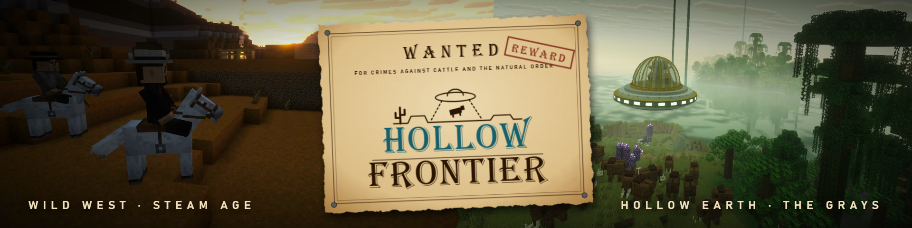

---

## The Frontier

**Black powder guns.** The Cap & Ball Revolver, Plains Rifle and Double-Barrel Muzzleloader are 1800s percussion guns with 3D models and animations. Each chamber is loaded by hand with a paper cartridge and a percussion cap. Every shot leaves a puff of white smoke, rain can make a gun misfire, and a shot to the head hits harder.

- **Seven gun enchantments:** Rifling, Quick Load, Deadeye, Choke, Dry Powder and Frugal, plus Focus for the phlogiston guns and vanilla's Infinity, Unbreaking and Mending. Find them at the enchanting table, from librarians and the town blacksmith, and in outlaw camps (Focus only at the table, from librarians and in general loot).

**Towns that feel lived in.** Every town has a name ("Coyote Springs", "POP. 212") on a welcome arch at the end of each street. Main streets of false-fronted buildings stand shoulder to shoulder, each furnished for its trade and with a sign over the door: the saloon, the sheriff's office and jail, the bank, the hotel, the general store, the gunsmith, the doctor ("teeth pulled"), the post and telegraph office, the bathhouse and barber, the Gazette office with its printing press, the schoolhouse, the chapel and the railroad depot. Out past the lanes are homesteads, a ranch with cattle, wheat fields, and a Boot Hill with headstones worth reading.

- **The Polar Survey's last letter**, waiting at every post office, points newcomers north: what to build, roughly where the crater is, and a bounty-board reward for news of the Survey.
- **Townsfolk** trade for copper and gold coins, each selling their own trade's goods. There are shopkeepers, bankers, blacksmiths, wranglers, prospectors, the gunsmith, the doctor, the schoolteacher, the preacher, the postmaster, the Gazette's editor and the railroad engineer.
- **They keep a day:** work by day, the saloon in the evening, home to bed at night. Street lamps light one by one at dusk.
- **Lawmen** (sheriffs, deputies, marshals and rangers) keep the peace, and they come for you if you break it.
- **Five barmaids,** each with her own look, pour seven saloon drinks, from Sarsaparilla to Moonshine. Drink enough and you get Tipsy, slur your words, and maybe wake up an hour later in a horse trough wearing somebody else's hat.
- **The Saloon Piano** plays Scott Joplin rags, and stops when a brawl breaks out.
- **Town cats** sleep on the bar, the porches and the livery hay.

**Bounties and the law.** Take a poster off the Bounty Board, track the outlaw to his camp and bring back his badge. The posters show a sketch of each outlaw's face, the reward and which way the hideout lies, and they're stamped TAKEN with your name and DEAD when you're done. If you shoot the wrong people, you earn wanted stars and a poster of your own (the artist has never seen you). At two stars the law shoots on sight, and at three a posse rides out after you.

**A stake in town.** Every town keeps its own opinion of you. Do right by one and you become a Regular, then a Neighbour, then a Pillar of the Town. The sheriff swears a Neighbour in as his deputy and has work for them: the night rounds, a drifter to bring in alive on the end of a lasso, a warrant to carry to the next town. A Neighbour can also buy the Old Place, the furnished homestead standing empty at the edge of town, with its barn, its corral and its garden, and build on from there. Brand your cattle, and take a wrangler's herd up the trail for pay.

**Outlaw raids.** Now and then, at night, a gang rides on the town you're in. They go for the bank vault, and with it the coins in your safe deposit box. Bring down the bagman before he gets away and every coin goes back.

**The saloon and the bank.** Play blackjack at the Card Table against the barmaid, but watch out for Josie's table. Keep your savings in a safe deposit box, where coins earn a little interest while you're away. Pick up The Frontier Gazette for rumours, sightings, coordinates, and the classifieds on the back page.

**The frontier talks.** Over 300 lines of chatter that follow what's going on. Folk notice the weather, your wanted stars, a robbery in town, the poster in your pocket and the hat on your head, and what they say changes as the story goes on.

**Dust devils.** On clear days, whirls of dust wander the deserts and badlands. They pick up whatever's lying around, fling chickens, spook horses and lift you off your feet. They also take your hat. Sneak to keep it.

**Also:** a lasso, dynamite, the cowboy outfit (a set bonus while riding), snakeskin boots, horseshoes and saddlebags for your horse, chairs you can sit in, and rattlesnakes in the desert.

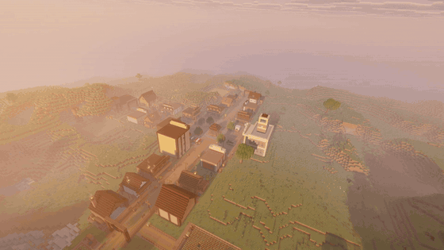
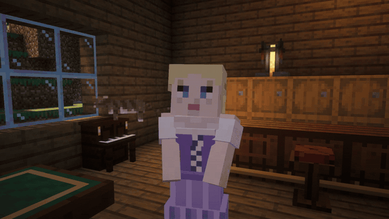
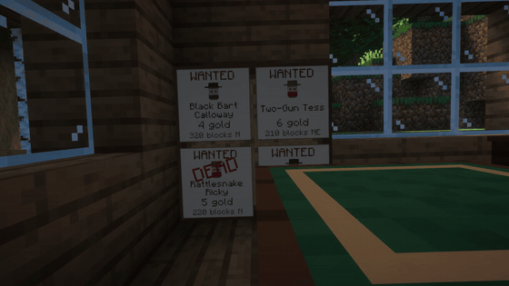
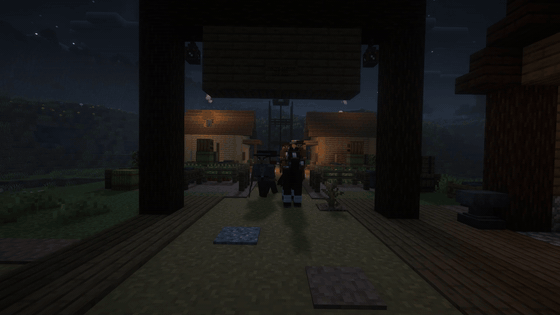

---

## The Steam Age

- **Boilers, copper pipes, steam tanks and pressure gauges.** Steam is `c:steam` on NeoForge's standard fluid capability, so it works with other mods' pipes and tanks.
- **The Steam Crusher** turns each ore into two dusts, doubling your ingots.
- **The Steam Drill and Steam Canisters** for mining on the go.
- **The Steam Handcar** rides the rails, and refuels at depot standpipes.
- **The Airship:** a coal-fired steam dirigible for two. Fly it north to find the Polar Gateways.
- **The Steam Submersible:** a fireless brass boat for two, charged with steam at the waterline, for the Still Sea or any other.

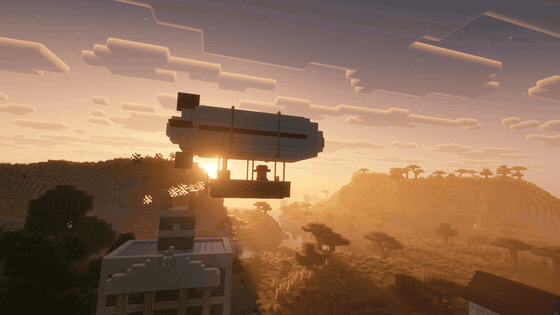

---

## The Hollow Earth

Wake a Polar Gateway's ring of stones with a Polar Resonator, then fall through Symmes' Hole into a world of its own. A golden crust arches 150 blocks overhead with stone spires and waterfalls hanging from it, and an inner sun that never sets.

- **Four biomes:** the Primordial Jungle, the Crystal Steppes, the Ember Badlands and the Concavian Highlands, each with its own plants, sounds and creatures.
- **The Still Sea:** an inner sea with no wind and no weather, so it lies flat as glass. Pale beaches, kelp forests on the shelf, and falls pouring in from the crust.
- **Sea life:** Great Sea Cows grazing the kelp, a Plesiosaur that dives for you if you feed it a fish, glowing Lampjellies that sting, and the Basilosaurus, which hunts whatever swims over deep water. Take a Harpoon: it reels in what's small, and what's big tows you.
- **The Steam Submersible:** a brass boat for two that runs on steam charged at the shore, with no fire aboard. Dive, hold your depth, and see by its lamp. A Basilosaurus will ram it.
- **The Drowned Quarter:** a sunken Kindled river port on the seabed, with glass domes that still hold air, guardians still on watch, and a vault. What's in the vault lets your saucer follow you down.
- **Megafauna:** woolly mammoths that charge as a herd, terror birds that outrun you, giant ground sloths and glyptodons.
- **New metals:** glowing phlogiston crystal, and starsteel for tools, a paxel and armor.
- **Sites to explore:** a lost Symmes expedition's dig, Kindled temples and observatories, an overgrown ziggurat, a tar pit full of bones, an abandoned phlogiston mine, a ruined starsteel foundry, shrines on the floating islands, and Gray relays hanging from the crust.
- **Dungeons below them:** the Kindled Catacombs, sealed by a vault puzzle; buried Gray complexes with cells, cold storage and a reactor; and the treasuries under the Sun Temple.
- **Loot worth the trip:** eight relics the town prospector buys for gold, explorers' maps to the big sites, a Concavian armor trim, and pottery sherds to brush out of the ruins.

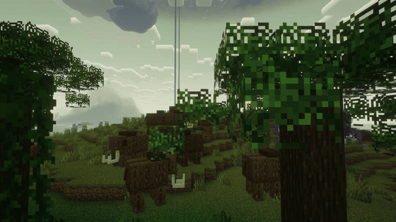
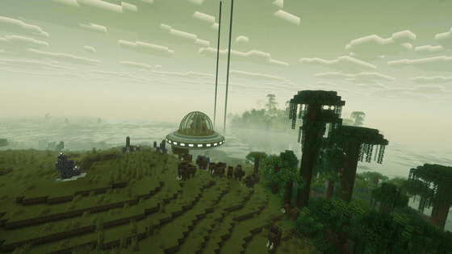

---

## Concavia

In the Highlands stand the Crystal Ruins, where the last **Kindled** live. They glow from within, the frontier calls them Lantern Men, and they trade in phlogiston. Earn their favour and they become your allies, and they'll tell you the truth about the Grays and the outlaws. Then climb the Sun Temple to face **the Sun Archon**, the last king of Concavia, in a three-phase boss fight. He drops the Phlogiston Core, the Starsteel Crown and the Sunstone Lens.

The **Concavian Codex** keeps track of how far you've come and tells you what's next.

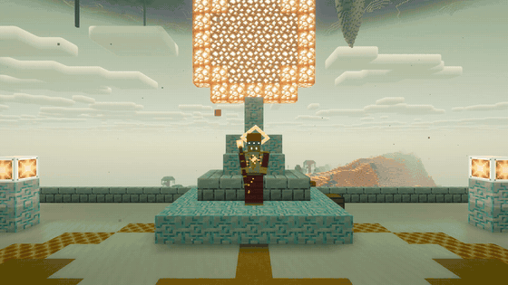

---

## The Grays

Something has been troubling the frontier: lights in the night sky, cattle found with surgical marks, crop circles in the town's wheat, and men in black dusters who show up after every sighting with a story about Venus.

- **Saucer flyovers and abductions** at night. Sneak if you don't want to be taken.
- **Taken:** once the men in black have started minding you, the Grays keep you. You wake in a pen aboard their ship with nothing on you, among other people from the frontier. Slip past the crew or through the vents, get your things back from the hold, take a Shock Rod off the surgeons' tray, free who you can, and leave in an escape pod. Or pull the cells out of the engine first, and get off in ninety seconds while it comes down. Nothing you carried is ever lost.
- **Gray field stations** in the Hollow Earth, where tagged and augmented megafauna come from.
- **Gray pens,** where men taken from the frontier wait in cells. Stop the procedure, free the captives, and carry their letters home.
- **Crash sites** with salvage to pry loose (alien alloy, a gravity drive, a beam emitter, a lens array and a navigation core) and a sealed cargo pod in the cockpit, holding the odd Gray gadget the prospector will buy: a doohickey that hums at ore, a rock that keeps you warm, a watch that runs backward, a marble that would rather be up, and a box that doesn't open.
- **Phlogiston weapons:** the Ray Pistol and Phlogiston Rifle fire beams that set what they hit alight, with no loading and rechargeable phlogiston cells. The rifle's beam goes through three creatures.
- **The Prototype Saucer:** build your own from the salvage. It has full 3D flight, a heat laser and a tractor beam that carries mobs, items and players.
- **The Mothership:** summon it with a Phlogiston Beacon and bring it down in a three-phase fight, on foot or in a dogfight from your own saucer.

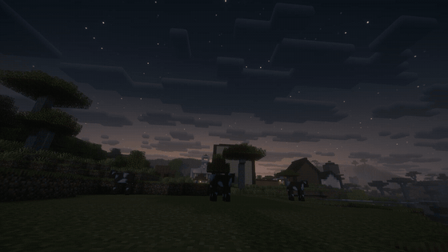
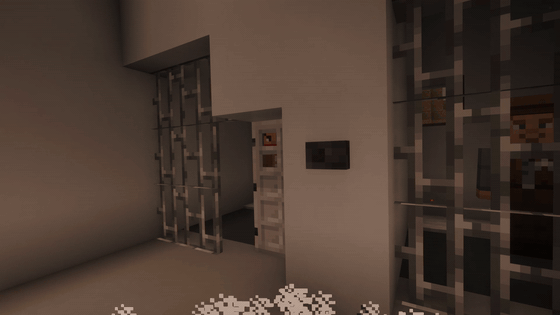
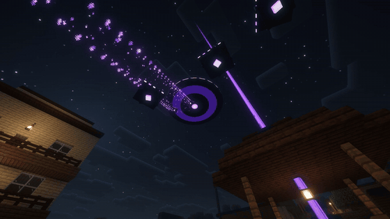

---

## After the Mothership

Bringing it down breaks the Grays' hold on the outlaws, but the story doesn't stop there.

- **Gray landings:** stranded saucers set down for the night under guard. Clear them before dawn to open their caches.
- **The Mothership comes back,** harder each time, and each rematch gives up a new saucer fitting: a Cloaking Device and a Cargo Hold.
- **Freed outlaws settle down:** hire them as deputies or set them up as prospectors.
- **Restore the Crystal Ruins** with phlogiston and starsteel, and wake their **waystones** for fast travel between the ruins and the Polar Gateways.
- **Mr. Gray:** a stranded Gray in a duster and a hat far too big for it starts turning up at the saloon. Expose it, or let it become a regular.

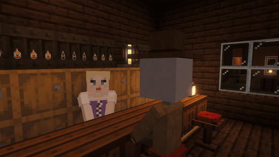

---

## A Frontier December

It comes on by the date and leaves by itself. The date is the server's, so everyone on a server sees the same thing, and existing worlds get all of it.

- **Town lamps** dress themselves one by one, a sprig and a red ribbon on each, and undress in January.
- **A tree in every town's square,** seven blocks of spruce with tin stars and candles lit after dark. It can't be hit or pushed and it harms nothing.
- **A Christmas Parcel** from the postmaster, one a year for each player: coins, cartridges, coffee and a **Fruitcake**. It takes five seconds to eat. Nobody will buy one.
- **Eggnog and Hot Cider** at the saloon, and **carols** on the piano, a carol every other tune.
- **The sleigh:** if there have been lights in the sky, the children decide it was a sleigh. The Gazette corrects them. The men in black find they prefer the children's version.
- **The Christmas truce:** from the 24th to the 26th no outlaw raid starts, and a sheriff lets one small fine go.
- **No snow.** Desert towns get a dry Christmas, and folk remark on it.

Turn it off, or keep it all year, in `hollowfrontier-season-server.toml`.

---

## Where to Start

A new world starts you in the nearest town's square. On a dedicated server with operators, set `spawn-protection=0`, or other players can't use the doors and chests around it. Talk to a town's **postmaster** first: the **Polar Survey's last letter** is waiting, and it keeps track of the road north (what to build, and roughly where the crater is). The **Hollow Frontier** and **Steam Age** advancement tabs lay out the rest of the frontier. Once you reach the Hollow Earth, craft a **Concavian Codex** (a book and a phlogiston shard) and it will guide you from there.

---

## Requirements

| | Version |
|---|---|
| Minecraft | 26.3 |
| NeoForge | 26.3.0.99 or newer |
| GeckoLib | 5.5.7 or newer (**required**) |

Install it on both the client and the server.

## Optional Mods

Hollow Frontier works on its own. If these mods are installed, it uses them:

- **JEI:** Steam Crusher recipes, plus info pages for steam blocks and things you can only find in the world.
- **Jade:** boiler fire, crusher progress, gauge readings, and the steam, fuel and phlogiston in your vehicles.
- **Curios:** wear the Sunstone Lens as a charm and the Kindled Sigil as a necklace.

**Shaders:** Complementary Reimagined and Bliss are good fits. With Iris, the mod's glowing parts glow under a shader pack the way vanilla's do. No shaders are bundled.

## Configuration

- `hollowfrontier-server.toml` (per world): outlaw raids, how often they come, how big they are, and what the bank stands to lose.
- `hollowfrontier-ufo-server.toml` (per world): saucer flyovers and landings, and whether their beams take players.
- `hollowfrontier-mysteries-server.toml` (per world): airship sightings, cattle mutilations, crop circles, and the men in black, each switchable.
- `hollowfrontier-towns-server.toml` (per world): whether towns replace the townsfolk and lawmen they lose, and how long each new arrival takes.
  It also holds `spawnAtTown`, on by default, which starts new worlds in the nearest town. A world chooses its spawn once, so set this in the `config` folder before creating the world.
- `hollowfrontier-saloon-server.toml` and `hollowfrontier-dust-devils-server.toml` (per world): saloon brawls and missing time; dust devils.
- `hollowfrontier-stake-server.toml` (per world): standing, deeds and cattle drives, each switchable; the deed's price; how far from town a place can be raised and how far a drive may go.
- `hollowfrontier-season-server.toml` (per world): December. `mode` is `AUTO` (by the server's date), `ALWAYS` or `NEVER`; `truce` is the Christmas truce.
- `hollowfrontier-startup.toml`: crafting-table brass. Turn it off if another mod makes brass.
- `hollowfrontier-client.toml` (yours alone, not the server's): `hollowScore` turns the Hollow Earth's own music and boss themes off and puts vanilla's back. `cameraKick` and `cameraShake` run from 0 to 1: how hard a gun kicks your view, and how much it shakes for heavy footfalls and blasts. Set both to 0 if a moving view makes you unwell.
- Gamerule `hollowfrontier:saucer_beams_players`: whether a player's saucer can beam up other players.
- Ops can set off raids, sightings, saucers and dust devils by hand with `/hollowfrontier raid|mystery|kindled|ufo|dustdevil ...`.

## Modpacks

Yes, go ahead. Hollow Frontier is MIT licensed. The one exception is the textures reworked from vanilla Minecraft's, which belong to Mojang. The LICENSE file in the jar has the details.

- Materials use the `c:` tags, and the recipes take any mod's ingots, dusts and ores.
- Spawns and structures go by biome tags, which a datapack can change. Polar Gateways spawn in any `c:is_snowy` biome.
- The bosses are tagged `c:bosses`, and other mods' mob catchers and teleporters leave them alone, along with the townsfolk.
- Other mods' pipes can feed the Boiler and Crusher.

## Credits

Made by RogueAppliance. The art is the mod's own, apart from a few textures reworked from vanilla's, and every sound is synthesized for it. The saloon piano plays Scott Joplin's ragtime (public domain), rendered from the Mutopia Project's public-domain scores. Built on NeoForge and GeckoLib.

The trailer uses "Still Pickin'" by Kevin MacLeod (incompetech.com), licensed under Creative Commons: By Attribution 4.0, and was filmed with the Complementary Reimagined shader pack by EminGT.

## Bugs and Ideas

Report bugs on [GitHub Issues](https://github.com/RogueAppliance/hollow-frontier/issues), with your versions and a log link from mclo.gs. Questions and ideas go in [Discussions](https://github.com/RogueAppliance/hollow-frontier/discussions).

<!-- LINKS: source and issues: https://github.com/RogueAppliance/hollow-frontier (the repo must be public first) / changelog: CHANGELOG.md -->
